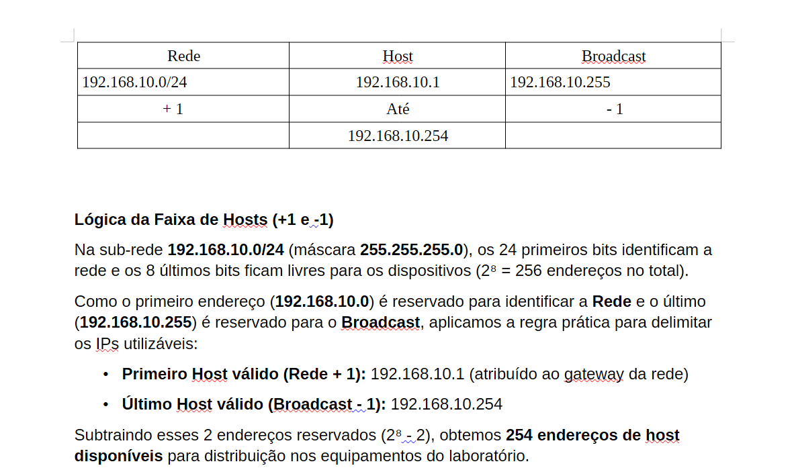
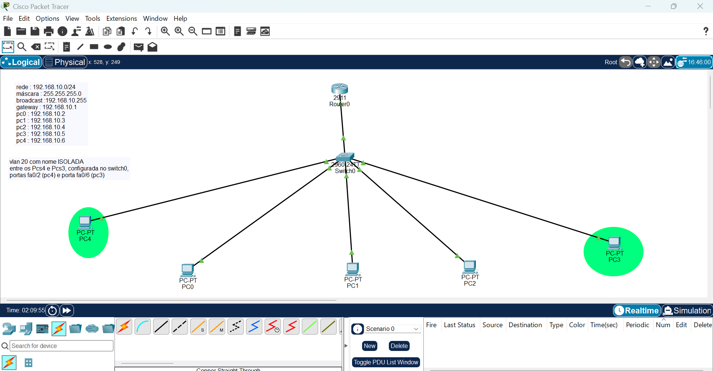
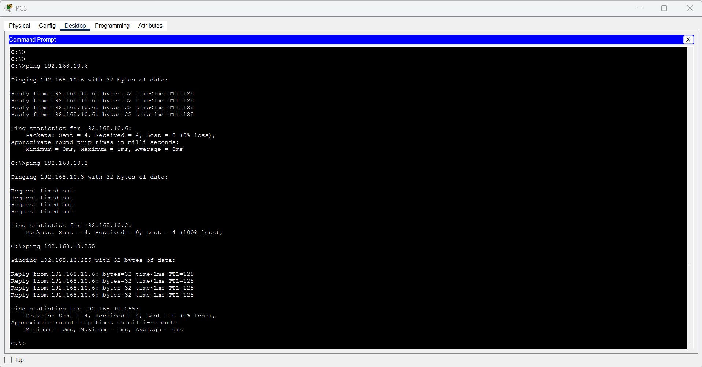
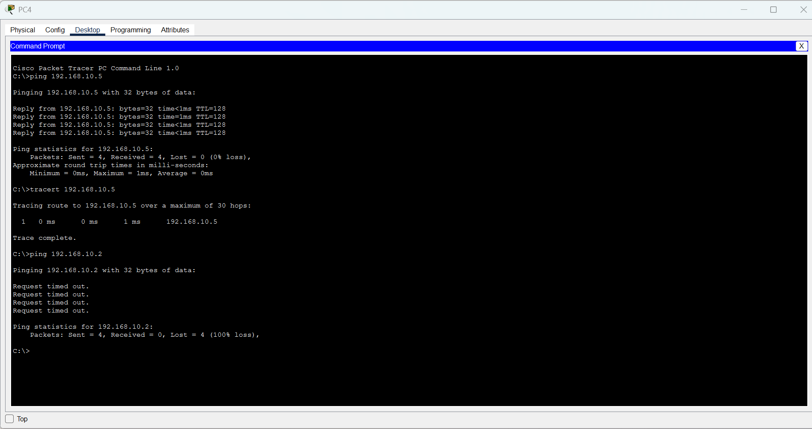

# Segmentação de Rede e Isolamento de Broadcast com VLAN (Cisco Packet Tracer)

Demonstração prática de endereçamento IPv4 (`192.168.10.0/24`), configuração de gateway em roteador Cisco, criação de VLAN em switch e validação do isolamento de broadcast no Cisco Packet Tracer.

## 1. Planejamento IPv4 (`192.168.10.0/24`)
* **Rede:** `192.168.10.0`
* **Máscara:** `255.255.255.0` (`/24`)
* **Gateway (`Router0`):** `192.168.10.1`
* **Hosts utilizáveis:** `192.168.10.1` a `192.168.10.254` (254 hosts)
* **Broadcast:** `192.168.10.255`

| Dispositivo | Interface | Endereço IP | Máscara | Gateway | VLAN |
| :--- | :--- | :--- | :--- | :--- | :--- |
| Router0 | `GigabitEthernet0/0` | `192.168.10.1` | `255.255.255.0` | — | — |
| PC0 | `FastEthernet0` | `192.168.10.2` | `255.255.255.0` | `192.168.10.1` | VLAN 1 |
| PC1 | `FastEthernet0` | `192.168.10.3` | `255.255.255.0` | `192.168.10.1` | VLAN 1 |
| PC2 | `FastEthernet0` | `192.168.10.4` | `255.255.255.0` | `192.168.10.1` | VLAN 1 |
| PC3 | `FastEthernet0` (`Fa0/6`) | `192.168.10.5` | `255.255.255.0` | `192.168.10.1` | VLAN 20 |
| PC4 | `FastEthernet0` (`Fa0/2`) | `192.168.10.6` | `255.255.255.0` | `192.168.10.1` | VLAN 20 |

## 2. Topologia

## 3. Teste de Broadcast Antes da VLAN

## 4. Configuração do Router0
enable
configure terminal
interface GigabitEthernet0/0
 ip address 192.168.10.1 255.255.255.0
 no shutdown
end
write

## 5. Configuração da VLAN 20 no Switch0
enable
configure terminal
vlan 20
 name ISOLADA
 exit
interface FastEthernet0/2
 switchport mode access
 switchport access vlan 20
 exit
interface FastEthernet0/6
 switchport mode access
 switchport access vlan 20
 end
write

## 6. Validação de Isolamento Broadcast (PC3)

## 7. Validação de Isolamento Broadcast (PC4)

